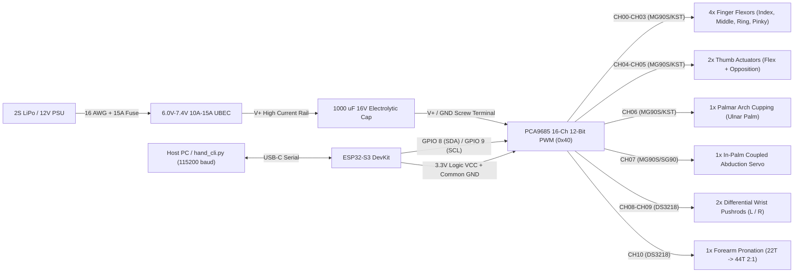

# Anthropomorphic Robotic Hand — Iteration 10 (v10.0) Build, Assembly & Wiring Guide

## 1. Architecture Overview (v10.0 Full-Actuation Production Release)

Iteration 10 (**v10.0**) upgrades the certified **v9.0** underactuated phalanges (`14` single-body watertight phalanx STLs with `3.50 mm` palmar moment arms, captive 6-sided M3 hex nut sockets, `≥ 1.25 mm` clamping walls, and profile-following dorsal snap-fit pinch-lip channels) into a **fully actuated 11-servo multi-DoF anthropomorphic hand and forearm system** (`26` single-body printable components + `1` full assembly reference = **27 watertight STLs** in `stl_exports_v10/`):

| Subsystem | Mechanical Implementation (`cad_v10/`) | Active Motion Range | Actuator Allocation |
| :--- | :--- | :---: | :--- |
| **Digits II–V Flexion** | Certified v9.0 3-phalanx fingers on 2-DoF MCP Cardan yokes (`0°` dorsal hard stops) | `0° → 95°` per joint | `4×` Micro-servos (`CH00–CH03`) |
| **Thumb Flexion & Opposition** | Male Thumb CMC pedestal (`palm_radial_v10`) + opposition fairlead + Thumb IP | `0° → 90°` flexion + opposition | `2×` Micro-servos (`CH04–CH05`) |
| **Palmar Arch Cupping** | Split radial/ulnar palm (`X = 0` axial M3 hinge at `[0, 42, +3] mm`) + dorsal elastic return | `0° → 30°` ulnar palmar cup | `1×` Micro-servo (`CH06`) |
| **MCP Abduction / Spread** | `4×` 2-DoF MCP Cardan yokes driven by slotted `abduction_linkage_v10` bar | `-15° → +15°` coupled splay | `1×` In-palm micro-servo (`CH07`) |
| **2-DoF Hollow Cardan Wrist** | `Ø40 mm` hollow Cardan gimbal (`Ø23 mm` Bowden tunnel) + dual differential M3 pushrods | `±45°` Pitch, `±35°` Yaw | `2×` High-torque standard servos (`CH08–CH09`) |
| **Forearm Pronation / Supination** | Rotating 9-servo barrel (`44T` integral spur gear) inside stationary outer cuff (`22T` pinion, 2:1) | `-85° → +85°` axial roll | `1×` High-torque standard servo (`CH10`) |

> **Why a Rotating 9-Servo Barrel?** Mounting the 7 tendon servos and 2 differential wrist servos *inside* the rotating `forearm_inner_barrel_v10` means axial pronation/supination (`±85°`) rotates the entire tendon bundle as one unit—zero tendon twist, zero cross-coupling into finger curl, and zero Bowden kinking.

---

## 2. Complete v10.0 Hardware & Electronics Bill of Materials (BOM)

### 2.1 Actuators (11 Servos Total)

| Qty | Component | Role in v10.0 | Specs & Recommended Models |
| :---: | :--- | :--- | :--- |
| **8×** | **Metal-Gear Micro-Servo** (`12.2 × 22.8 × 22.0 mm`) | `4×` finger flexors (`CH00–CH03`), `2×` thumb flex/opp (`CH04–CH05`), `1×` palmar cupping (`CH06`, in barrel) + `1×` in-palm abduction (`CH07`) | **Budget**: TowerPro `MG90S` (6.0V, `~2.2 kg·cm`, `~1.5–1.8 N`/tip)<br>**HV Upgrade**: `KST DS215MG` (7.4V, `~3.7 kg·cm`, `~3.5–5.5 N`/tip) |
| **3×** | **High-Torque Standard Servo** (`40.0 × 20.0 × 37.5 mm`) | `2×` differential wrist Pitch/Yaw pushrods (`CH08–CH09`) + `1×` forearm pronation 22T pinion drive (`CH10`) | `DS3218` (20 kg·cm metal-gear, 6.0V–6.8V, 25T spline) or `MG996R` (10–13 kg·cm). **Use a `270°` `DS3218` on `CH10`** to achieve the full `±85°` forearm roll (`±170°` pinion rotation across the 2:1 `22T→44T` reduction). |

### 2.2 Electronics & High-Current Power Distribution

| Qty | Component | Specification / Notes |
| :---: | :--- | :--- |
| **1×** | **ESP32-S3 DevKit** (e.g., ESP32-S3-DevKitC-1) | Main MCU running `firmware/hand_controller_v10/hand_controller_v10.ino` (I2C: `GPIO 8` SDA, `GPIO 9` SCL; USB-C Serial `115200 baud`). Mounts on `forearm_outer_sleeve_v10` electronics tray. |
| **1×** | **PCA9685 16-Channel 12-Bit I2C PWM Driver** | Standard `62 × 25 mm` breakout (`56.0 × 19.0 mm` M3 mounting hole pattern, default I2C address `0x40`, `50 Hz` PWM). |
| **1×** | **6.0V–7.4V 10A–15A UBEC / Buck Converter** *(or 2S 7.4V LiPo + 6.0V 15A UBEC)* | Dedicated high-current servo power rail feeding the PCA9685 `V+` screw terminal. (Use `6.0V` for `MG90S`/`MG996R`; `6.8V–7.4V` only if all 11 servos are HV-rated such as `KST DS215MG` + `DS3218`). |
| **1×** | **`1000 µF` 16V Electrolytic Capacitor** | Installed across the PCA9685 `V+` / `GND` power rail (observe polarity!) to absorb simultaneous stall-current spikes and prevent brownouts. |
| **1×** | **16 AWG Silicone Power Wire + XT60 / Inline 15A Fuse + Kill Switch** | Main battery/PSU feed to UBEC and PCA9685 `V+` terminal block. |
| **4×** | **22–26 AWG Dupont Jumper Wires** | `3.3V` (or `5V` logic), `GND`, `SDA (GPIO 8)`, `SCL (GPIO 9)` between ESP32-S3 and PCA9685 logic header. |

> [!CAUTION]
> **NEVER power the 11 servos from the ESP32-S3 `5V` or `3.3V` pin or from a USB port!** Under simultaneous grasp + wrist torque, 8 micro-servos and 3 high-torque DS3218 servos can draw **8–14 A peak**. Always feed servo power exclusively into the PCA9685 **`V+` / `GND` screw terminal block** from a dedicated `10A–15A` UBEC, and **tie the ESP32-S3 `GND` and PCA9685 `GND` together** to establish a common logic reference.

### 2.3 Mechanical Fasteners, Tendons, Bearings & Linkages

| Qty | Component | Application |
| :---: | :--- | :--- |
| **~30×** | **M3 Socket / Button Head Cap Screws** (`M3×12`, `M3×14`, `M3×16`, `M3×20`, `M3×25 mm`) | `14×` phalanx/MCP/CMC hinge pins (`M3×12–16`), `4×` MCP Z-axis yaw pins (`M3×16`), `1×` axial palmar cupping hinge (`M3×25` or `Ø3 mm` steel rod), `4×` wrist Cardan ring X/Z pivot pins (`M3×12–14`), `12×` standard servo mounts (`M3×10–12`), `4–6×` PCA9685/ESP32 standoffs. |
| **~25×** | **M3 Hex Nuts** (`5.5 mm` nominal AF) & **M3 Nyloc Nuts** | `14×` press-fit into captive 6-sided hex sockets (`5.65 mm` AF) on phalanx `+X` forks; nyloc nuts for Cardan wrist pivots & pushrod rod-ends. |
| **~24×** | **M2 × 6 mm / M2 × 8 mm Self-Tapping Screws** | `16×` micro-servo mounting tabs (`8× MG90S` into `Ø1.8 mm` pilot bores) + `7×` winch spool horn retention screws (`servo_spool_v10`). |
| **4×** | **M3 Ball-Joint Tie-Rod Ends** + **2× M3 Threaded Rod (`~65 mm`)** | Dual differential wrist pushrods linking `CH08` (Left) and `CH09` (Right) servo horns to `palm_radial_v10` pushrod ears (`[±24.0, -2.0, -8.0] mm`). |
| **1×** | **Printed Low-Friction Pronation Journal + PTFE/Silicone Grease** | `forearm_inner_barrel_v10` features an integral **`Ø68.0 mm` (`R = 34.0 mm`)** cylindrical bearing journal (`y ∈ [-156.5, -174.0] mm`) running directly inside the concentric **`Ø68.8 mm` (`R = 34.40 mm`)** bore of `forearm_outer_sleeve_v10` (`0.40 mm` radial FDM clearance, lubricated with dry PTFE or silicone grease). |
| **~2.5 m** | **PTFE Bowden Tubing (`2.0 mm OD × 1.0 mm ID`)** | Low-friction flexible liners routing all 7 forearm flexor/opposition/cupping tendons cleanly through the `Ø23.0 mm` hollow Cardan wrist core. |
| **~8 m** | **`Ø0.8 mm` Braided UHMWPE Dyneema Line** (50–80 lb test) | Zero-creep flexor, thumb opposition, and palmar cupping tendons. |
| **~1.5 m** | **Silicone / Latex Dorsal Return Bands** (`Ø1.5–2.0 mm` cord or flat `2 mm` strips) | Snap-fit into the profile-following dorsal pinch-lip channels of all 5 digits + dorsal cupping return across the `palm_radial` / `palm_ulnar` seam. |

---

## 3. PCA9685 `CH00–CH10` Wiring Table & System Block Diagram

### 3.1 System Wiring Architecture



### 3.2 I2C & Logic Connections (ESP32-S3 ↔ PCA9685)

| ESP32-S3 Pin | PCA9685 Logic Pin | Signal / Purpose |
| :---: | :---: | :--- |
| **`GPIO 8`** | `SDA` | I2C Data (`400 kHz` Fast Mode / `100 kHz` Standard) |
| **`GPIO 9`** | `SCL` | I2C Clock |
| **`3V3`** | `VCC` | Logic supply (`3.3V` safe for PCA9685 logic side) |
| **`GND`** | `GND` | **Mandatory common ground** shared with UBEC `GND` |
| *(Not Connected)* | `OE` | Leave unconnected (pulled low on board) or wire to an E-Stop GPIO |
| *(Separate UBEC)* | `V+` (Terminal Block) | **Dedicated `6.0V–7.4V` (`10A–15A`) servo power rail + `1000 µF` cap** |

### 3.3 PCA9685 Channel Allocation (`CH00–CH10`)

Matches `firmware/hand_controller_v10/config.h` (`FW_VERSION = "10.0.0"`, `I2C_SDA_PIN = 8`, `I2C_SCL_PIN = 9`, `I2C_CLOCK_HZ = 400000`, `PCA9685_ADDR = 0x40`, `PWM_FREQ_HZ = 50`, `CONTROL_LOOP_HZ = 50`):

| PCA9685 Channel | Firmware Alias | Mechanical Function | Servo Type | Mounting Location | Software Range (`rest_deg`) | Pulse Calibration (`min / neutral / max µs`) | Invert | Slew Limit |
| :---: | :--- | :--- | :--- | :--- | :---: | :---: | :---: | :---: |
| **`CH00`** | `index` | Index Finger Flexion (MCP/PIP/DIP) | `MG90S` / `KST DS215MG` | Forearm Inner Barrel (`-X` col) | `0° → 95°` (`15°`) | `600 / 868 / 2300` | `false` | `180°/s` |
| **`CH01`** | `middle` | Middle Finger Flexion (MCP/PIP/DIP) | `MG90S` / `KST DS215MG` | Forearm Inner Barrel (`-X` col) | `0° → 95°` (`15°`) | `600 / 868 / 2300` | `false` | `180°/s` |
| **`CH02`** | `ring` | Ring Finger Flexion (MCP/PIP/DIP) | `MG90S` / `KST DS215MG` | Forearm Inner Barrel (`-X` col) | `0° → 95°` (`15°`) | `600 / 868 / 2300` | `false` | `180°/s` |
| **`CH03`** | `pinky` | Pinky Finger Flexion (MCP/PIP/DIP) | `MG90S` / `KST DS215MG` | Forearm Inner Barrel (`-X` col) | `0° → 95°` (`15°`) | `600 / 868 / 2300` | `false` | `180°/s` |
| **`CH04`** | `thumb_flex` | Thumb Flexion (CMC/IP) | `MG90S` / `KST DS215MG` | Forearm Inner Barrel (`+X` col) | `0° → 90°` (`15°`) | `650 / 917 / 2250` | `false` | `160°/s` |
| **`CH05`** | `thumb_opp` | Thumb Opposition / Circumduction | `MG90S` / `KST DS215MG` | Forearm Inner Barrel (`+X` col) | `0° → 90°` (`25°`) | `700 / 1117 / 2200` | `false` | `150°/s` |
| **`CH06`** | `cup` | Palmar Arch Cupping (4th/5th Ray) | `MG90S` | Forearm Inner Barrel (`+X` col) | `0° → 30°` (`5°`) | `900 / 1067 / 1900` | `false` | `90°/s` |
| **`CH07`** | `spread` | Coupled Finger Abduction / Spread | `MG90S` / `SG90` | In-Palm (`palm_radial_v10`) | `-15° → +15°` (`0°`) | `1000 / 1500 / 2000` | `false` | `90°/s` |
| **`CH08`** | `wrist_left` | Differential Wrist Pushrod (Left `-X`) | `DS3218` / `MG996R` | Forearm Inner Barrel (`-Z` front) | `-60° → +60°` (`0°`)* | `800 / 1500 / 2200` | `false` | `120°/s` |
| **`CH09`** | `wrist_right` | Differential Wrist Pushrod (Right `+X`) | `DS3218` / `MG996R` | Forearm Inner Barrel (`-Z` front) | `-60° → +60°` (`0°`)* | `800 / 1500 / 2200` | **`true`** | `120°/s` |
| **`CH10`** | `pronation` | Forearm Pronation / Supination (`22T→44T`) | `DS3218` (`270°`) / `MG996R` | Forearm Outer Sleeve (`+X`, `-Y` drop-in) | `-85° → +85°` (`0°`) | `550 / 1500 / 2450` | `false` | `110°/s` |
| `CH11–CH15` | *(Spare)* | Reserved for future sensors / expansion | — | — | — | — | — | — |

*\*`CH08` (`wrist_left`) and `CH09` (`wrist_right`, inverted) are driven by the firmware's differential mixer `mixWrist(pitchDeg, yawDeg)` mapping `Pitch ∈ [-45°, +45°]` and `Yaw ∈ [-35°, +35°]` with proportional anti-saturation clamping into `[-60°, +60°]`.*

---

## 4. 26-Part + Assembly STL Inventory (`stl_exports_v10/`)

All **27 STL meshes** exported by `./venv/bin/python3 generate_hand_stl_v10.py` into `stl_exports_v10/` passed `verify_v10_complete()` (`exit code 0`): **100% watertight solid manifolds (`is_watertight == True`, `volume > 0`)**, with every single one of the **26 individual printable components** verified as **1 connected body** (`len(m.split(only_watertight=False)) == 1`) and fitting inside the `220×220×250 mm` Anycubic Kobra 2 Neo build volume.

| STL File (`stl_exports_v10/`) | Bytes | Size (KB) | Triangles | Volume ($\text{mm}^3$) | Bodies | Watertight |
| :--- | ---: | ---: | ---: | ---: | ---: | :---: |
| `index_distal_v10.stl` | 247584 | 241.8 | 4950 | 2332.5 | 1 | **True** |
| `index_intermediate_v10.stl` | 353084 | 344.8 | 7060 | 2037.4 | 1 | **True** |
| `index_proximal_v10.stl` | 365684 | 357.1 | 7312 | 3020.8 | 1 | **True** |
| `middle_distal_v10.stl` | 250284 | 244.4 | 5004 | 2629.4 | 1 | **True** |
| `middle_intermediate_v10.stl` | 361484 | 353.0 | 7228 | 2394.8 | 1 | **True** |
| `middle_proximal_v10.stl` | 376584 | 367.8 | 7530 | 3666.1 | 1 | **True** |
| `ring_distal_v10.stl` | 248084 | 242.3 | 4960 | 2282.7 | 1 | **True** |
| `ring_intermediate_v10.stl` | 354184 | 345.9 | 7082 | 2121.5 | 1 | **True** |
| `ring_proximal_v10.stl` | 368384 | 359.8 | 7366 | 3174.8 | 1 | **True** |
| `pinky_distal_v10.stl` | 242484 | 236.8 | 4848 | 1841.6 | 1 | **True** |
| `pinky_intermediate_v10.stl` | 349284 | 341.1 | 6984 | 1611.9 | 1 | **True** |
| `pinky_proximal_v10.stl` | 361184 | 352.7 | 7222 | 2447.8 | 1 | **True** |
| `thumb_distal_v10.stl` | 244784 | 239.0 | 4894 | 3258.6 | 1 | **True** |
| `thumb_proximal_v10.stl` | 383784 | 374.8 | 7674 | 3712.7 | 1 | **True** |
| `index_mcp_yoke_v10.stl` | 58484 | 57.1 | 1168 | 545.9 | 1 | **True** |
| `middle_mcp_yoke_v10.stl` | 58484 | 57.1 | 1168 | 545.9 | 1 | **True** |
| `ring_mcp_yoke_v10.stl` | 58484 | 57.1 | 1168 | 545.9 | 1 | **True** |
| `pinky_mcp_yoke_v10.stl` | 58484 | 57.1 | 1168 | 545.9 | 1 | **True** |
| `abduction_linkage_v10.stl` | 50484 | 49.3 | 1008 | 1363.7 | 1 | **True** |
| `palm_radial_v10.stl` | 524284 | 512.0 | 10484 | 40697.1 | 1 | **True** |
| `palm_ulnar_v10.stl` | 230284 | 224.9 | 4604 | 25413.9 | 1 | **True** |
| `wrist_cardan_ring_v10.stl` | 49684 | 48.5 | 992 | 6717.9 | 1 | **True** |
| `forearm_inner_barrel_v10.stl` | 293984 | 287.1 | 5878 | 245493.7 | 1 | **True** |
| `forearm_outer_sleeve_v10.stl` | 132884 | 129.8 | 2656 | 193984.5 | 1 | **True** |
| `pronation_pinion_v10.stl` | 78484 | 76.6 | 1568 | 11035.3 | 1 | **True** |
| `servo_spool_v10.stl` | 46884 | 45.8 | 936 | 617.3 | 1 | **True** |
| `robotic_hand_full_assembly_v10.stl` | 6098884 | 5955.9 | 121976 | 563422.6 | 25* | **True** |

*\*`robotic_hand_full_assembly_v10.stl` contains the `25` structural hand-and-forearm bodies (`14` phalanges + `4` MCP yokes + `abduction_linkage` + `palm_radial` + `palm_ulnar` + `wrist_cardan_ring` + `forearm_inner_barrel` + `forearm_outer_sleeve` + `pronation_pinion`); `servo_spool_v10.stl` is exported separately so you can print `7×` copies for the `CH00–CH06` micro-servo horns.*

### Automated `verify_v10_complete()` Audit Summary
- **Manifold & Bed Fit**: All 27 disk STLs pass `is_watertight == True` and `volume > 0`; all 26 individual components pass `bodies == 1` and fit inside `220×220×250 mm` (largest part: `forearm_inner_barrel_v10.stl` at `79.8 × 177.6 × 79.8 mm`).
- **Multi-DoF Zero-Collision Sweeps (`< 0.05 mm³` tolerance)**:
  - All 4 fingers (`index, middle, ring, pinky`): MCP flexion (`0°–95°` on MCP yokes), MCP yaw (`±15°` in palm sockets), PIP (`0°–95°`), and DIP (`0°–95°`).
  - Palmar arch cupping: `palm_ulnar_v10` vs `palm_radial_v10` (`0°–30°`).
  - Thumb CMC (`0°–90°` on `palm_radial_v10`) & Thumb IP (`0°–90°`).
  - 2-DoF Hollow Cardan Wrist: `wrist_cardan_ring_v10` vs `forearm_inner_barrel_v10` (`±45°` Pitch) and `palm_radial_v10` vs `wrist_cardan_ring_v10` (`±35°` Yaw).
  - Forearm Pronation: `forearm_inner_barrel_v10` vs `forearm_outer_sleeve_v10` (`±85°` axial roll) + synchronized `22T`/`44T` spur gear mesh (`m = 1.75 mm`, `GEAR_CENTER_DIST = 57.75 mm`).
- **One-Directional Hard Stops**: All 14 digit joints (`4× MCP`, `4× PIP`, `4× DIP`, `Thumb CMC`, `Thumb IP`) rigidly block `-5°/-10°` hyperextension (`min = 0.363 mm³`).
- **11-Servo Drop-In Clearance**: All `7×` barrel `MG90S` bays (`±X` drop-in), `1×` in-palm `MG90S` bay (dorsal drop-in), `2×` barrel `DS3218` wrist bays (`-Z` palmar drop-in), and `1×` outer-sleeve `DS3218` pronation bay (`-Y` rear drop-in) clear standard servo envelopes cleanly.

---

## 5. Phased 3D Printing Plan (Anycubic Kobra 2 Neo — `220×220×250 mm`)

All **26 printable parts** fit comfortably inside a standard `220×220×250 mm` FDM build volume. Use a `0.40 mm` nozzle, **Arachne** wall generator, **4–5 perimeters**, **40–50% Gyroid infill** (PLA+ or PETG; **60% Gyroid** recommended for `wrist_cardan_ring_v10`, `pronation_pinion_v10`, and `forearm_inner_barrel_v10`), and **Tree Supports (On Build Plate Only)** with **Support Blockers** over all internal tendon bores (`Ø2.2–2.8 mm`) and dorsal snap-fit pinch-lip channels.

| Print Batch | Parts (`stl_exports_v10/`) | Layer Height | Orientation & Slicer Notes |
| :---: | :--- | :---: | :--- |
| **Batch 1** *(Digits)* | All `14` phalanges (`index/middle/ring/pinky` proximal/intermediate/distal + `thumb` proximal/distal) | `0.12 mm` | Horizontal, **palmar side down / dorsal crown UP (`+Z`)**. `45°` snap-fit pinch lips and `0.70 mm` nail beds print upward 100% support-free. Block `Ø2.20 mm` bores. |
| **Batch 2** *(MCP & Linkage)* | `4×` MCP Cardan yokes (`*_mcp_yoke_v10.stl`), `abduction_linkage_v10.stl`, `7×` copies of `servo_spool_v10.stl` | `0.12 mm` | Print MCP yokes flat on side or base with build-plate tree support under yaw tongue; print `abduction_linkage_v10` and `servo_spool_v10` flat on the bed. |
| **Batch 3** *(Split Palm & Wrist Ring)* | `palm_radial_v10.stl`, `palm_ulnar_v10.stl`, `wrist_cardan_ring_v10.stl` | `0.16 mm` | Stand `palm_radial_v10` and `palm_ulnar_v10` upright on carpal/wrist end (`5 mm` brim) so `Ø2.8 mm` conduits print vertically; print `wrist_cardan_ring_v10` flat (`Y`-axis vertical) so the `Ø23 mm` central bore is circular and strong. |
| **Batch 4** *(Forearm Barrel)* | `forearm_inner_barrel_v10.stl` (`79.8 × 177.6 × 79.8 mm`) | `0.16 mm` | Stand **vertically (`Y`-axis upright)** on the rear `44T` gear face (`5–8 mm` outer brim). Ensures concentric `44T` gear teeth and smooth `Ø68.0 mm` bearing journal without flat spots. |
| **Batch 5** *(Outer Sleeve & Pinion)* | `forearm_outer_sleeve_v10.stl`, `pronation_pinion_v10.stl` | `0.16 mm` | Print `forearm_outer_sleeve_v10` upright on its rear flange; print `pronation_pinion_v10` flat (`Y`-axis vertical) at `0.12–0.16 mm` with `5` walls for crisp `22T` tooth profiles. |

---

## 6. Step-by-Step Mechanical Assembly, Bowden Routing & Firmware Bring-Up

### Step 1: Phalanx Prep & Captive M3 Hex Nuts
1. Clear any stringing from all `Ø3.4 mm` pin bores and `Ø2.2 mm` palmar tendon bores using a `3.2 mm` / `2.2 mm` drill bit twisted by hand.
2. Press **14× M3 hex nuts** into the 6-sided hexagonal sockets on the `+X` fork walls of all phalanges (use a soldering iron tip briefly only if oversized; they should seat flush with zero rotation).
3. Assemble each finger (`distal → intermediate → proximal`) using M3 socket/button head screws from the `-X` counterbore side. Verify smooth `0° → 95°` flexion (`0° → 90°` on thumb) and a crisp `0°` dorsal hard stop.

### Step 2: MCP Cardan Yokes, Coupled Abduction Linkage & Split Cupping Palm
1. Mount the **in-palm abduction micro-servo (`CH07`, `MG90S`/`SG90`)** into the open-back dorsal bay of `palm_radial_v10` using `2× M2` screws. Center the servo (`90°` / `1500 µs`) before attaching its horn.
2. Seat the `4×` **MCP Cardan yokes** (`index`, `middle` into `palm_radial_v10`; `ring`, `pinky` into `palm_ulnar_v10`) using vertical `Z`-axis M3 pivot screws (`±15°` smooth yaw sweep).
3. Drop `abduction_linkage_v10` over the 4 rear MCP crank pins (`Ø2.2 mm` pins / M2 screws) and couple the central drive clevis to the `CH07` servo horn. Confirm that sweeping `CH07` smoothly splays and adducts all four MCP yokes simultaneously.
4. Bolt the 4 assembled fingers onto their respective MCP yoke horizontal `X`-axis flexion tongues, and bolt `thumb_proximal_v10` onto the male Thumb CMC pedestal of `palm_radial_v10`.
5. Join `palm_ulnar_v10` to `palm_radial_v10` along the axial `Y`-axis cupping hinge (`[0.0, 42.0, +3.0] mm`) using an M3 hinge bolt/rod. Confirm `0° → 30°` smooth palmar cupping and install a dorsal silicone return band across the cupping tie-pins.

### Step 3: Hollow Cardan Wrist & PTFE Bowden Pass-Through
1. Cut **7 lengths** of `2.0 mm OD × 1.0 mm ID` PTFE Bowden tubing (`~220–260 mm` each) for `Index, Middle, Ring, Pinky, Thumb Flex, Thumb Opp, and Palmar Cupping`.
2. Seat the distal ends of the PTFE liners into the `palm_radial_v10` / `palm_ulnar_v10` carpal conduit seats, bundling all 7 tubes cleanly through the **`Ø23.0 mm` central bore** of `wrist_cardan_ring_v10`.
3. Mate `palm_radial_v10`'s dorsal/palmar wrist ears (`z = ±18.5 mm`) to the `Z`-axis yaw bosses of `wrist_cardan_ring_v10` with M3 bolts + nyloc nuts (`±35°` free yaw).
4. Mate `wrist_cardan_ring_v10`'s lateral `X`-axis pitch bores to the front gimbal arms (`x = ±23.0 mm`) of `forearm_inner_barrel_v10` with M3 bolts + nyloc nuts (`±45°` free pitch).
5. Verify that pitching `±45°` and yawing `±35°` moves the PTFE bundle smoothly inside the `Ø23 mm` hollow core with zero kinking.

### Step 4: 9-Servo Rotating Forearm Barrel, Differential Pushrods & 22T/44T Pronation Drive
1. Drop the **2× `DS3218` wrist servos (`CH08` Left, `CH09` Right)** into the front palmar (`-Z` drop-in) bays of `forearm_inner_barrel_v10` and secure with `4× M3` screws each.
2. Assemble the **2× M3 ball-joint pushrods** (`~65 mm` center-to-center) connecting `CH08` and `CH09` servo horns to `palm_radial_v10`'s pushrod ears (`[±24.0, -2.0, -8.0] mm`). *(Wait until after Step 6 centering to tighten the servo horn screws!)*
3. Slide the **7× `MG90S` / `KST DS215MG` tendon servos (`CH00–CH06`)** into the rear dual-column bays (`4` on `-X`, `3` on `+X`) and fasten with `14× M2` screws. Attach a printed `servo_spool_v10` to each servo horn.
4. Route the `Ø0.8 mm` braided Dyneema tendons: tie a stopper knot seated inside each fingertip's `Ø4.0 × 2.5 mm` distal knot pocket, thread down the `z = -3.50 mm` palmar phalanx bores, through the MCP yoke center bore, through the PTFE Bowden liners, and out to each corresponding `servo_spool_v10`. Tie the palmar cupping tendon to the `palm_ulnar_v10` eyelet (`[22.0, 54.0, -7.0] mm`) and route to `CH06`.
5. Snap the dorsal silicone elastic return cords into the profile-following dorsal pinch-lip channels of all 5 digits (knotting inside the `Ø2.0 mm` distal nail-bed cross-bore and anchoring at the MCP yoke / palm cross-pins).
6. Apply a light coat of PTFE/silicone grease to the `Ø68 mm` bearing journal of `forearm_inner_barrel_v10` and slide it into `forearm_outer_sleeve_v10`.
7. Mount the **`CH10` `DS3218` pronation servo** into `forearm_outer_sleeve_v10` with `4× M3` screws, press `pronation_pinion_v10` (`22T`) onto its 25T horn/spline, and mesh cleanly with the barrel's `44T` integral spur gear (`GEAR_CENTER_DIST = 57.75 mm`).
8. Mount the **ESP32-S3 DevKit** and **PCA9685** onto the outer sleeve electronics tray with M3 standoffs and complete the wiring from Section 3.

### Step 5: Firmware Flashing & First-Power-On Calibration
1. **Disconnect all servo horns/spools mechanically** before first power-on so no tendon or pushrod can over-travel.
2. Flash `firmware/hand_controller_v10/hand_controller_v10.ino` to the ESP32-S3 using Arduino IDE or PlatformIO (dependencies: `Wire`, `Adafruit PWM Servo Driver Library`).
3. Connect the `6.0V–7.4V` UBEC to the PCA9685 `V+`/`GND` terminal (with `1000 µF` cap) and open the interactive Python CLI:
   ```bash
   ./venv/bin/python3 firmware/hand_controller_v10/hand_cli.py --port /dev/cu.usbserial-0001
   ```
   *(To test the CLI and differential wrist mixer without hardware attached, run with `--dry-run`.)*
4. Send `PRESET REST` — all 11 servos smoothly slew to their calibrated neutral angles.
5. With power on at `REST`, attach:
   - `CH07` abduction horn at neutral (`0°` splay),
   - `CH08` & `CH09` wrist pushrod horns with the palm held level (`0°` pitch, `0°` yaw),
   - `CH10` pronation `22T` pinion with the barrel centered (`0°` roll),
   - `CH00–CH06` tendon spools with slight preload (zero slack, fingers held at `0°` dorsal hard stop).
6. Fine-tune individual tendon zero points using `TRIM <ch> <us_offset>` and test presets (`OPEN`, `FIST`, `PINCH`, `CYLINDER`, `TRIPOD`, `SPREAD`, `WAVE`). Keep `RELAX` ready at any time to immediately cut PWM holding torque.
